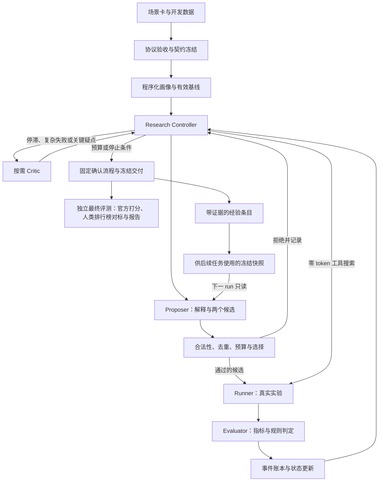

# BoHack 2026 Research Agent 系统方案

> 技术路线：PydanticAI + 确定性 Research Controller\
> 项目暂定名：**BudgetLab**\
> 文档版本：v3.0（合并定稿）· 2026-11-13\
> 目标赛道：倍漾量化｜Research Agent 系统设计\
> 开发预算：按 36 小时安排，提交截止为 11/15 8:00；开工时间以选手手册为准，窗口更短时按第 15 节削减\
> 文档性质：实施设计与验收标准，不代表功能或效果已经实现

## 0. v3.0 相对 v2.0 的改动

v3.0 以 v2.0 为底座，合并了另一份方案中的评测锚点与研究空间设计，并修正两处问题。未列出的部分沿用 v2.0。

| 编号 | 改动 | 原因 | 位置 |
|---|---|---|---|
| 1 | 正式评测改用两道带人类排行榜的 Kaggle 题（经 MLE-bench）；Bank Marketing 改为开发与演示题 | v2.0 只有内部对照，完成度缺少外部参照 | 3.2、5.4、13 |
| 2 | 白名单增加 TF-IDF 文本选项（P0）和一个受限的自定义特征函数（P1） | 原空间只有 3 个模型族加 3 种特征操作，零 token 随机搜索很可能打平，模型的语义能力无处发挥 | 3.1、6.1 |
| 3 | 确认由“同切分换训练种子”改为“换切分种子”；`min_effect` 由基线的噪声地板标定 | 实测部分模型族换训练种子后分数完全相同，确认不提供新信息 | 6.2、9.1 |
| 4 | 实验便宜时两个候选都执行 | 小数据上 token 比算力稀缺 | 7、8.3 |
| 5 | 同空间随机搜索既是对照组，也是 Controller 可调度的零 token 动作 | 能用程序搜索解决的不调用模型 | 4、7、8.6 |
| 6 | 对照定为 4 组，正式矩阵为 2 题 × 4 组 × 3 次，共 24 个 run；优先消融选“有无按需调度” | 直接检验赛题“何时调用大模型”的主张 | 13 |
| 7 | 工程简化：删除暂缓队列；切分只实现分层；FLAML 移出范围；预留—结算与事件一致性给出最小实现 | 控制 P0 工程量 | 8、10、12 |
| 8 | 开工前增加数据门禁，并核实时间窗 | 两者决定后续取舍 | 1.3、5.4、15 |
| 9 | CV 默认折数由 3 调为 5 | 两道正式题数据小，算力便宜，折数多则噪声小 | 9.1 |

## 1. 赛题与具体要求

### 1.1 研究闭环

在给定数据、工具和资源预算下，自主完成：

```text
规划 → 收集证据 → 提出假设 → 实验或分析 → 验证 → 修正
```

交付可追溯、可复现、能够根据经验改进后续研究的成果。根据用户提供的群公告补充说明，本地小模型不是硬性要求；只有一个 LLM 时，所有角色可以共用该模型，仍需评价 Token 成本和研究效率。

### 1.2 系统必须回答的问题

1. 给定预算内完成了什么研究任务，任务指标提高了多少？
2. 花了多少输入/输出 Token、费用、实际模型请求和墙钟时间？
3. 哪些假设得到实验支持，哪些未达到预设条件，哪些证据不足？
4. 下一步为何改变：Agent 主动提议、规则触发，还是执行错误导致？
5. 每个结论能否回到配置、切分、日志和程序计算的指标？
6. 积累的经验是否改善后续任务，改善是否经独立对照检验？

### 1.3 时间与交付边界

赛事方《赛道和赛题设置》文档写明：11/14 10:00 锁定赛道，11/15 8:00 项目提交截止；提交物为代码仓库链接、路演 PPT 和项目说明。开工时间该文档没有写明：从 11/13 20:00 起算是 36 小时，从 11/14 10:00 起算是 22 小时。本版按 **36 小时**排期，实际开工时间以选手手册为准；窗口缩短时按第 15 节的削减顺序处理。建议另备演示录屏。

本版优先级：

- **P0**：接口与 Schema 兼容、固定评测契约、真实实验闭环、预算账本、公平对照、证据链；数据门禁通过时加上人类排行榜对标。
- **P1**：两候选调度、按需 Critic、自定义特征函数、最小跨 run 经验库及一项针对核心主张的消融。
- **P2**：更多研究领域、多模型路由、复杂调度、更多迁移任务和预测误差图。

## 2. 项目定位

### 2.1 一句话介绍

**BudgetLab 是一个预算感知、证据约束的机器学习研究助手：理解场景，提出可检验假设，执行真实实验，按预设规则验证与修正，并输出成本透明、可以复现的结果。**

### 2.2 核心设计

1. **任务协议先冻结**：预测时点、合法特征、主指标、切分、预算和确认规则在搜索前确定。
2. **角色职责明确**：Proposer 提出候选，Critic 解释与建议，程序负责实验有效性、指标、预算和晋级。
3. **正常一轮一次提案调用**：一次输出上一轮解释、下一步假设和两个实验规格，实验便宜时两个都执行；复杂审查按事件触发。
4. **预算使用可观测信号**：优先依据实测耗时、重复状态、失败记录和剩余资源，不使用未经校准的自报分数决定一切。
5. **证据驱动经验积累**：经验附带适用条件、来源、反例和版本，通过冻结经验库的对照验证迁移价值。
6. **零 token 工具优先**：数值比较、去重和同空间采样搜索都由程序完成，模型只用于需要语义判断的环节。
7. **成绩有外部参照**：正式评测题带人类排行榜，完成度不只和自己的基线比。

### 2.3 对外主张与对应证据

| 主张 | 必须提供的证据 |
|---|---|
| 能完成研究闭环 | 至少两轮真实实验，以及结果如何改变下一步行动 |
| 能降低研究成本 | 同协议、同硬预算下的费用/Token/时间与性能对照 |
| 能理解业务约束 | 场景卡、提出的协议、约束验收记录与错误案例 |
| 能持续改进 | 来源任务经验、冻结版本、目标任务有无经验的重复对照 |
| 结果可复现 | 数据哈希、切分清单、配置、依赖锁、训练种子和复现命令 |
| 成绩有外部参照 | 官方打分脚本给出的分数、人类排行榜百分位、是否过中位线与奖牌线 |

未测得的提升不写成成果；未验证跨任务迁移时，只说明已实现经验记录与检索。

## 3. MVP 研究任务与场景设计

### 3.1 输入与输出

第一版支持带场景卡的表格二分类任务；数据可以是 CSV 或 JSON，允许含文本列。

**输入**：开发数据、目标列、字段字典、预测时点与业务目标、资源预算；隐藏 holdout 由评测端保管。

**输出**：有效的研究协议、基线、假设与实验轨迹、冻结的最优方案、最终评测、成本统计、证据报告和复现入口。

范围优先限定为：

- 二分类优先；多分类在核心闭环稳定后接入。
- `f1_macro`、`accuracy`；`roc_auc` 在 MVP 中仅用于二分类。
- 数值/类别特征、缺失值处理、少量受控特征操作；文本列的 TF-IDF（P0）；一个受限的自定义特征函数（P1，见 6.1）。
- LogisticRegression、RandomForest、HistGradientBoosting 三个模型族。
- 目标完成约 8–16 个真实实验执行（两个候选都执行时偏上限）；实际次数受预算约束，基线、pilot、确认与失败尝试都计数。
- 单实验超时、最多一次自动配置修复、固定切分和训练种子计划。

一次实验可以包含多折或多种子训练，因此同时统计实际 `fit` 次数；不能仅用“实验数相同”声称计算成本相同。

### 3.2 场景卡与代表性任务

场景卡至少描述：预测发生在何时、可获得哪些信息、字段如何产生、样本是否重复属于同一实体、业务错误代价、未来部署数据来自哪里。

| 场景 | Agent 需要做出的判断 | 程序可验证的依据 |
|---|---|---|
| 预测时不可用的字段 | 根据字段字典判断应排除哪些特征 | 预测时点与字段可用性规则 |
| ID 或实体字段 | 判断其是否适合做特征、分组键或仅作索引 | 场景卡、实体重叠与切分清单 |
| 类别不平衡 | 选择与业务目标一致的指标并研究改进 | 搜索前冻结的指标及类别诊断 |
| 时间或群组变化 | 提议适当切分和验证方式 | 可核验时间戳/分组信息及隔离检查 |

P0 先完成“预测时不可用字段”与常规表格任务。分布漂移/时间切分不在 v3.0 范围，Runner 只实现分层切分。

v3.0 的任务安排：

| 用途 | 数据 | 场景 | 主指标 | 外部参照 |
|---|---|---|---|---|
| 开发与演示 | UCI Bank Marketing | 拨打电话前预测是否订购；含预测时不可用字段 | f1_macro | 无 |
| 正式评测 1 | Kaggle random-acts-of-pizza（经 MLE-bench） | 发帖时预测求助能否成功；文本加元数据；含自然的字段可用性问题 | roc_auc | 人类排行榜 |
| 正式评测 2 | Kaggle spaceship-titanic（经 MLE-bench） | 常规表格二分类；检验搜索与语义特征 | accuracy | 人类排行榜 |

Bank Marketing 的任务明确为“拨打电话前预测是否订购”。官方数据说明将 `duration` 定义为本次联系时长，并在下载包说明中提醒真实预测应排除该字段。[1] 应审查全部字段的可用性，不能只硬编码一个列名。它只用于开发和演示，不进正式结果表，避免对着评测题调系统。

random-acts-of-pizza 是“预测时不可用字段”场景的自然版本：赛题说明写明，发帖时不可得的字段已从测试集中移除。[12] 因此官方测试集保留的字段可以作为协议验收的参考答案，数据到手后以实际文件核对。两点注意：

- **待核实**：`giver_username_if_known` 可能仍保留在测试集中，但它是发帖之后才知道的信息。属实则由场景卡规则在契约中排除，并在报告中说明排行榜高分段可能受其影响。
- 该题的人类阈值为：中位线 0.5996、铜牌 0.6921、银牌 0.7648、金牌 0.9791。[13] 数值以官方打分脚本的实际输出为准。

spaceship-titanic 的阈值同样以官方打分脚本的输出为准。MLE-bench 对多数比赛重新划分了测试集，与人类排行榜的比较不完全等价，[11] 报告中需注明。

随机 holdout 中仍可能保留同样的不可用字段，因此隐藏测试集必须与特征可用性检查配合。人工注入的陷阱标明为合成压力测试，固定生成脚本、种子与真值；不要把注入效果当作自然数据上的发现。

### 3.3 任务理解与固定协议分开评价

- **端到端轨道**：所有可比 Agent 接收相同场景卡和开发信息，先提交 DraftProtocol；评测端按预先编写的规则验收，记录首次正确率、修订次数和成本，然后冻结 TaskContract。
- **固定协议轨道**：所有系统获得相同的合法特征、主指标和切分，直接比较搜索质量和成本。

若 TaskContract 已经明确指标、切分和排除列，就不能再把这些选择记作 Agent 自主发现的贡献。协议验收最多一次修订，仍不合法则记为任务理解失败；不能默默补成正确答案后宣称端到端成功。

端到端轨道只在含字段可用性问题的题上进行（Bank Marketing、random-acts-of-pizza）；spaceship-titanic 只走固定协议轨道。

### 3.4 结果解释边界

选模型和调参也可以构成实验，但每轮要写清观察依据、对照与可检验变化。优先一次改变一个研究因素，复合方案明确标记，避免将效果归因于未经单独比较的因素。

示例：在固定模型、特征和切分下，检验类别权重能否改善 macro-F1，并同时记录各类别表现。预期提升是待检验预测，不是实际指标。

## 4. 总体架构



### 4.1 职责与调用边界

| 部件 | 职责 | 运行方式 |
|---|---|---|
| Proposer | 首次规划、解释上一轮、提出两个假设/实验候选 | 正常每轮一次 LLM 调用入口 |
| Critic | 复杂诊断、证据审查、总结与 next_focus | 按事件调用；无最终裁决权 |
| Controller | 状态、停止、候选选择、工具搜索调度、恢复与预算 | 普通 Python |
| Runner / Evaluator | 执行、计算指标、检查有效性、判定和晋级 | 普通 Python |
| 工具搜索 | 在白名单空间内采样规格，不调用模型；与随机搜索对照组共用代码 | 普通 Python，由 Controller 调度 |
| 任务适配器 | 把各题数据读成统一表格；声明目标列、指标与提交格式 | 普通 Python，每题一个 |
| 报告生成器 | 从账本填充事实和复现说明 | 模板为主，至多一次可选解释调用 |
| 经验检索器 | 按结构化条件匹配冻结经验 | 程序匹配，不依赖向量库 |

初始规划并入第一次 Proposer。需要换方向时使用同一个 Proposer 的 `replan` 模式；MVP 不再每轮独立调用 Planner、Hypothesis 和 Engineer。

### 4.2 模型与执行权限

- 仅有一个模型时，所有角色共用它，通过上下文大小、调用频率和输出上限控制成本。
- 存在多模型时，普通提案使用低成本模型，关键审查可按策略升级；记录升级触发原因与实际收益。
- Agent 只输出受控规格，Runner 仅实现白名单操作。实验进程不得访问隐藏测试数据、修改评测器或读写经验库版本。
- P0 使用受控 Pipeline，不开放任意代码生成和安装依赖。P1 的自定义特征函数是唯一的代码入口，限制见 6.1。`frozen=True` 只是对象约束，实际数据与工具边界仍由程序和运行环境保证。

## 5. 框架选择与开工门禁

### 5.1 选择 PydanticAI

本方案采用 PydanticAI 承担模型调用和结构化输出，使用普通 Python 控制研究循环。官方支持类型化输出及工具输出、原生结构化输出和提示词输出模式。[2] AgentScope 也可采用相同架构；已经熟悉 AgentScope 的团队无需为了本方案迁移。[9]不要同时叠加多个编排框架。

### 5.2 第一项工作：验证真实托管接口

在选定依赖版本后，以最终准备使用的嵌套 Schema 做兼容性测试并保存结果：

1. 确认 Base URL、模型 ID、认证、超时和输出长度参数。
2. 测试默认 Tool Output；若不支持，检查 Native Output，再考虑 Prompted Output。[2]
3. 验证 discriminated union、可空字段、候选数量限制、非法参数和额外字段拒绝。
4. 故意返回缺字段/错误类型，确认最多一次修复、仍失败的停止路径与成本归账。
5. 检查输入/输出 Token、缓存/其他计费项和失败请求的 usage 返回情况。
6. 核对 SDK、框架和 HTTP 层重试，关闭隐式重试或统一纳入请求预算。
7. 若计划启用 P1 的自定义特征函数：按固定函数签名让模型写 10 次 pandas 特征函数，记录通过静态检查且可执行的比例；低于预设门槛（建议 70%）则不启用。

Prompted Output 仍需要程序解析和校验，不能当作提供方保证的 JSON。复杂 union 不兼容时，可换成更简单的传输 Schema，再映射并验证为同一内部严格 Schema；业务约束不能随之取消。

### 5.3 版本与完成标准

保存依赖锁、实际模型配置、输出模式、Schema 版本和协议测试记录。`agent.run()` 是逻辑调用入口，可能含多次真实模型请求；报告以实际请求为准。框架的 usage 限制作为第二道检查，全局预算仍由项目统一管理。[2][3]

### 5.4 数据门禁：两道 Kaggle 题能否准备并出分

正式评测依赖 MLE-bench 的数据准备与官方打分。[10] 开工后尽早完成并保存记录：

1. 在 Kaggle 账号设置中生成 API 凭证，放到 `~/.kaggle/kaggle.json`。
2. 在 Kaggle 网页上分别确认两道题的参赛规则。[14]
3. 安装 Git-LFS，克隆 mle-bench 仓库，执行 `git lfs fetch --all`、`git lfs pull` 和 `pip install -e .`。
4. 执行 `mlebench prepare -c random-acts-of-pizza` 和 `mlebench prepare -c spaceship-titanic`。
5. 用一份示例提交验证 `mlebench grade-sample <提交文件> <题目名>` 能给出分数与阈值判定。
6. 核对 random-acts-of-pizza 训练集与测试集的字段清单，确认 3.2 中待核实的字段。

通过标准：两道题都能在本地出分。任何一步卡住超过 1 小时即判定未通过：正式评测退回 Bank Marketing 加另一个公开二分类表格数据，使用自留的隐藏测试集，放弃人类排行榜对标，并在报告中如实说明。门禁不通过不影响第 6–12 节的设计。

## 6. Agent 角色、Schema 与裁决边界

### 6.1 Proposer：一次产生两个候选

输入只包含任务摘要、开发数据画像、合法空间、最近结果、当前最优、剩余预算和最多三条匹配经验。输出上一轮解释、当前方向与两个具有实质差异的候选。

以下是 Pydantic v2 的内部 Schema 设计示例；与第 9 节代码可组合验证。它约束数据形状，字段是否属于当前数据集、引用是否存在等语义规则仍由程序校验。带判别字段的 union 用于明确允许的操作和模型参数。[4]

```python
from typing import Annotated, Literal
from pydantic import BaseModel, ConfigDict, Field


class StrictModel(BaseModel):
    model_config = ConfigDict(extra="forbid", frozen=True, allow_inf_nan=False)


Metric = Literal["f1_macro", "accuracy", "roc_auc"]


class TextTfidfSpec(StrictModel):
    columns: tuple[str, ...] = Field(min_length=1, max_length=3)
    max_features: int = Field(default=2000, ge=200, le=5000)
    ngram_max: Literal[1, 2] = 1
    svd_components: int | None = Field(default=None, ge=10, le=200)


class PreprocessingSpec(StrictModel):
    numeric_imputer: Literal["median", "mean"] = "median"
    numeric_scaler: Literal["none", "standard"] = "none"
    categorical_imputer: Literal["most_frequent", "constant"] = "most_frequent"
    categorical_encoder: Literal["onehot"] = "onehot"
    text: TextTfidfSpec | None = None


class DropColumns(StrictModel):
    kind: Literal["drop_columns"]
    columns: tuple[str, ...] = Field(min_length=1)


class Log1pColumns(StrictModel):
    kind: Literal["log1p"]
    columns: tuple[str, ...] = Field(min_length=1)


class AddMissingIndicators(StrictModel):
    kind: Literal["missing_indicator"]
    columns: tuple[str, ...] = Field(min_length=1)


class CustomFeatures(StrictModel):  # P1；契约未开启时一律拒绝
    kind: Literal["custom_features"]
    code: str = Field(min_length=1, max_length=2000)
    new_columns: tuple[str, ...] = Field(min_length=1, max_length=8)


FeatureAction = Annotated[
    DropColumns | Log1pColumns | AddMissingIndicators | CustomFeatures,
    Field(discriminator="kind"),
]


class LogisticSpec(StrictModel):
    family: Literal["logistic_regression"]
    c: float = Field(default=1.0, gt=0, le=100)
    class_weight: Literal["balanced"] | None = None
    max_iter: int = Field(default=300, ge=50, le=1000)


class ForestSpec(StrictModel):
    family: Literal["random_forest"]
    n_estimators: int = Field(default=100, ge=20, le=300)
    max_depth: int | None = Field(default=None, ge=2, le=32)
    min_samples_leaf: int = Field(default=1, ge=1, le=50)
    class_weight: Literal["balanced"] | None = None


class HistBoostSpec(StrictModel):
    family: Literal["hist_gradient_boosting"]
    learning_rate: float = Field(default=0.1, gt=0, le=1)
    max_iter: int = Field(default=100, ge=20, le=300)
    max_leaf_nodes: int = Field(default=31, ge=2, le=63)
    min_samples_leaf: int = Field(default=20, ge=2, le=100)


ModelSpec = Annotated[
    LogisticSpec | ForestSpec | HistBoostSpec,
    Field(discriminator="family"),
]


class ExperimentSpec(StrictModel):
    model: ModelSpec
    preprocessing: PreprocessingSpec
    feature_actions: tuple[FeatureAction, ...] = Field(default=(), max_length=4)


class Hypothesis(StrictModel):
    statement: str = Field(min_length=1)
    evidence_refs: tuple[str, ...] = Field(min_length=1)
    comparator_experiment_id: str = Field(min_length=1)
    decision_policy_id: str = Field(min_length=1)
    proposed_change: str = Field(min_length=1)
    predicted_metric_delta: float | None = Field(default=None, ge=-1, le=1)


class Candidate(StrictModel):
    candidate_id: str = Field(min_length=1)
    hypothesis: Hypothesis
    experiment: ExperimentSpec


class ProposalBatch(StrictModel):
    previous_result_interpretation: str
    intent: Literal["explore", "refine", "pivot", "replan"]
    direction: str
    candidates: tuple[Candidate, ...] = Field(min_length=2, max_length=2)


class CriticAdvice(StrictModel):
    explanation: str
    evidence_refs: tuple[str, ...] = Field(min_length=1)
    next_focus: str
    lesson_drafts: tuple[str, ...] = ()


class EvaluationRecord(StrictModel):
    experiment_id: str
    execution_status: Literal["ok", "failed", "timeout", "invalid"]
    policy_status: Literal["candidate_pass", "confirmed_pass", "not_met", "inconclusive", "invalid"]
    mean_paired_delta: float | None = None
    confirmation_deltas: tuple[float, ...] = ()
    evidence_refs: tuple[str, ...] = Field(min_length=1)
    computed_by: Literal["evaluator"] = "evaluator"
```

`EvaluationRecord` 只由程序构造，不能作为 LLM 输出类型。实验 ID、训练种子、资源参数和评测协议由 Controller 绑定，Agent 不得通过挑选种子提高分数。

Runner 还需校验：引用的列存在且合法；目标列不能进入特征；对照有效且协议一致；两个候选 ID 与规范化规格不重复；操作顺序无冲突；log1p 输入满足定义域；编码后维度和内存不过限。模型族与稀疏/稠密矩阵兼容性由 PipelineFactory 处理，内存不足时拒绝，不静默改变实验。文本列必须列在契约的 `text_columns` 中；HistGradientBoosting 搭配文本特征时必须设置 `svd_components`，否则判为非法规格，不由程序静默降维。

**自定义特征函数（P1）的限制**：仅当契约的 `allow_custom_features` 为真时接受。`code` 必须定义 `add_features(df)`，输入不含目标列和编号列，返回行数与顺序不变的表格，并新增 `new_columns` 声明的列。只允许逐行、无状态的加工，不得从数据中拟合任何统计量。执行前做静态检查：只允许使用 pandas 与 numpy，禁止导入其他模块、访问文件与网络、使用 `eval`/`exec` 和双下划线属性。执行时在实验子进程内带超时运行，并校验行数、列名、数据类型以及两次执行结果一致。每个规格最多一个自定义特征动作；检查不通过按非法规格处理，计入修复次数。启用该动作的运行，其合法空间比未启用的更宽，评测时单独标注（见 13.2）。

### 6.2 程序裁决：工程门槛，不冒充显著性检验

将自然语言假设与结构化比较规则分开。假设引用契约中的 `decision_policy_id`，协议明确主指标、方向、最小实际收益、切分、确认切分种子与规则版本。Agent 不能看过结果后改门槛。

默认工程策略：

1. 先检查执行、数据边界、协议和比较对象是否有效。
2. 探索阶段计算相同折上的候选减对照差值，均值达到 `min_effect` 才成为待确认候选。
3. 最终候选按有效开发主指标选最高，且须相对初始有效基线达到门槛；并列时依次选训练耗时更少、规范化规格哈希更小的候选。确认阶段固定比较该候选与初始有效基线：在契约预先固定的几套**确认切分**上（切分种子与搜索切分不同），两者使用相同的折逐套比较，不临时挑选较弱对照。每条假设的局部对照结果与最终晋级分开保存。
4. 确认差值的中位数达到 `min_effect`，且正差比例达到契约阈值，才标记 `confirmed_pass`。这是工程复核规则，不是 p 值或显著性结论。
5. 最终返回原有效基线，或按协议确认通过的方案；另存探索最优结果，不能把未确认的结果写成已确认提升。

**为什么确认要换切分而不是换训练种子**：v2.0 的确认使用同一切分、不同训练种子。在 scikit-learn 上用 4000 行合成数据实测（3 折、f1_macro），LogisticRegression 与 HistGradientBoosting 换 3 个训练种子后分数完全相同，确认不提供新信息；同一模型换 3 个切分种子后，分数相差 0.008–0.017，是原默认门槛 0.002 的数倍。数据超过 1 万行时 HistGradientBoosting 会自动启用早停，训练种子才带来约 0.0005 的差异。因此 v3.0 的确认改为换切分种子。

**`min_effect` 的标定**：搜索开始前，用有效基线在契约固定的几套标定切分上各评一次（不调用模型），取各套主指标均值的标准差作为噪声地板；`min_effect` 取契约下限 `min_effect_floor` 与噪声地板中的较大者，写入契约后冻结。这是偏保守的取法：同折配对比较的噪声通常小于单个模型跨切分的波动。

状态解释：

| 状态 | 含义 |
|---|---|
| candidate_pass | 探索结果达到预设门槛，等待确认 |
| confirmed_pass | 完成固定确认计划并达到工程门槛 |
| not_met | 有效且完整的比较未达到门槛，不自动等于理论假设被否定 |
| inconclusive | 确认未完成、所需证据不足，或协议指定的可判定条件未满足 |
| invalid | 实验/比较无效；执行失败不当作假设反证 |

禁止使用“配对折差均值 > 2×折间标准差”直接宣称统计显著。CV 折之间相关，朴素独立样本检验会低估不确定性；若要做正式检验，应单独实现并说明其假设与修正。[5] 多切分确认仍不等于跨数据集泛化证明。

### 6.3 按需 Critic

触发情形：持续停滞、复杂执行失败、证据矛盾、异常大幅提升、关键结论疑点。普通参数错误由程序给出精确错误并允许一次 Proposer 修复；普通未达标结果由下一轮 Proposer 读取，不额外调用 Critic。

Critic 只给解释、经验草稿和 next_focus。它不能覆写指标、有效性状态、停止条件或确认规则。即使没有预算调用 Critic，程序仍要完成关键有效性检查；同一未解决事件最多触发一次额外审查。

### 6.4 报告与方向变更归因

数字、表格、配置和引用由模板从账本填入。可选 LLM 仅生成解释性文本，仍需校验实验引用和数字一致性。

每次方向调整记录：`trigger_source`（agent/rule/error）、`proposed_by`、`selected_by`、`reason`、`evidence_refs`、前后方向。规则触发重规划、Agent 提出新方向可以同时成立，分别统计，避免把 if 规则的触发归给 Agent。

## 7. Research Controller 与停止流程

下面是控制流伪代码，辅助函数仍需实现，不是可直接运行的项目代码。

```python
async def run_research(task, frozen_memory):
    state = initialize_state(task, frozen_memory)
    state.eda = profile_development_data(task)
    state.baseline = run_and_score_baseline_with_budget(task)
    if not state.baseline.is_valid:
        return freeze_failed_run(state, reason="invalid_baseline")
    state.contract = calibrate_min_effect_and_freeze(
        task, state.baseline
    )  # 噪声地板标定，不调用模型

    while state.budget.can_explore_with_finalization_reserve():
        if state.stop_policy.should_stop():
            break

        if should_review_once(state) and state.budget.can_review():
            advice = await metered_critic(build_review_context(state))
            state.record_advice(advice)  # 建议不覆盖裁决

        if state.should_run_tool_search():  # 零 token：开局或停滞时在白名单空间内采样
            specs = sample_specs_in_legal_space(state)
            ledger.record_tool_search(specs)
        else:
            batch = await metered_proposer(build_compact_context(state))
            selection = controller_validate_and_select(batch, state)
            ledger.record_selection(selection)
            state.apply_selection(selection)  # 更新拒绝/重试/停滞计数
            specs = selection.selected  # 实验便宜时两个都执行，否则只留排序第一的
            if not specs:
                continue  # 连续无合法候选达到上限后，由 stop_policy 结束

        for spec in specs:
            job = bind_protocol_seeds_and_limits(spec, task)
            result = runner.execute_with_reservation(job)
            evaluation = evaluator.score_and_decide(result, state)
            ledger.commit_experiment(result, evaluation)
            state.apply_programmatic_evaluation(evaluation)

    finalist = choose_one_candidate_under_frozen_policy(state)
    confirmation = run_reserved_confirmation(finalist, state)  # 在确认切分上与初始基线比较
    delivery_spec = select_confirmed_spec_or_baseline(state, confirmation)
    delivery_model = refit_on_all_development_with_reserved_budget(delivery_spec)
    frozen_run = freeze_delivery(state, confirmation, delivery_model)
    write_report_from_development_evidence(frozen_run)
    write_unpublished_lesson_drafts(frozen_run)
    return frozen_run


# 独立评测端：预先登记的各组运行全部冻结后，统一进行最终评价。
# 每个已冻结 run 的最终交付方案只评价一次，不把结果反馈给搜索。
# Kaggle 题的最终评价调用官方打分脚本，并换算人类排行榜位置。
def finalize_benchmark(frozen_runs, sealed_holdout):
    assert_all_runs_and_protocols_frozen(frozen_runs)
    results = evaluate_frozen_deliveries_once(frozen_runs, sealed_holdout)
    return render_benchmark_report(results)
```

状态迁移、实测耗时、预算预留/结算和失败原因全部写事件流。以下情况明确结束：预算不足以安全进入下一轮、开发目标与确认条件达成、收益递减、重复或无合法候选达到上限、不可恢复错误、人工取消。

停止参数属于配置并在运行前冻结。触发条件只读开发结果，不能查询 holdout 分数。最终确认失败时回退有效基线并如实报告；不在看过确认结果后无限换候选重试。交付规格确定后，在完整开发集上使用冻结的训练设置重新拟合，保存模型及哈希再冻结交付；不能把某一 CV 折模型直接当最终模型。重训失败或预算不足时记为交付失败，不伪报完成。

## 8. Budget Controller 与候选选择

### 8.1 统一成本账本

记录输入/输出 Token、缓存及其他可计费项、实际模型请求、逻辑角色调用、费用及币种、实验执行数、fit 次数、CPU/训练时间、墙钟时间、失败与重试。基线、画像、pilot、确认、最终重训/评测和报告消耗均记录，分阶段展示且包含在总成本中。

提供方有 usage 和单价时计算费用；单价未知则费用为 `null/unknown`，不写成零。失败请求缺失 usage 时记录未知或保守估计，不能直接释放全部额度当作没有消耗。

### 8.2 调用前预留，调用后结算

- 全局预算覆盖 Proposer、Critic、协议修订、报告及所有隐式重试。
- 每次请求预留预计输入、允许的最大输出及请求名额；限制提供方输出长度。
- 收到 usage 后结算；未返回 usage 的请求保留不确定标记，使用保守剩余额度决定是否继续。
- 每次实验预留估计时间、fit 名额与内存上限，超时终止进程并记录实际消耗。
- 搜索开始前估算最终确认、重训、评测与交付的资源，保留这一额度。比例预留仅作初值，若不足以覆盖实际确认计划，应缩小搜索或拒绝启动。
- 不确定性较大时采用更保守预留；不承诺在提供方计费不可观测时绝对零超支。

**最小实现**：一个全局计数器在每次请求前按“估计输入加最大输出”扣减，返回后按 usage 修正；实验按超时上限预留时间与 fit 名额。上面更细的规则在时间不足时降为记录项，但失败请求不得记为零消耗。

PydanticAI 的部分 usage/费用检查发生在响应返回后，不能替代调用前预留。[3]

### 8.3 两候选准入与排序

每轮默认两个候选。规则按顺序执行，结果可解释：

1. 合法性检查：数据边界、协议、操作、参数与引用。
2. 重复检查：规范化规格与运行条件的哈希；有意的确认/复现属于不同用途，不能误删。
3. 资源检查：根据历史耗时与数据规模估计是否可执行。
4. 合格候选排序：优先验证尚未解决的证据问题；停滞时偏向未覆盖方向；其余条件相同优先低成本候选。
5. 执行数量：估计单次实验耗时不超过契约中的 `cheap_experiment_seconds` 且 fit 余额充足时，两个合格候选都执行；否则只执行排序第一的。小数据上 token 比算力稀缺，这样每次模型调用可以换来两个实验。
6. 保存选中理由和未选中理由，固定排序规则与并列处理方式。

`selected` 表示选中执行，可以是一个或两个；`rejected` 表示非法、重复或超预算；合法但本轮未执行的候选记为 `not_run`。v3.0 不实现暂缓队列。

成本估计使用模型族、样本/特征量、CV/种子计划和历史耗时；冷启动用保守上限或计费的小样本 pilot。新颖度先用模型族/特征操作/研究方向的离散差异，不用未经验证的复杂距离公式。

LLM 的预测提升只用于记录或辅助解释，不作为硬准入权重。候选多样性是研究选择手段，不为了演示拒绝而构造无价值候选。

### 8.4 Token 控制与可测目标

- Proposer 使用结构化摘要：当前最优、最近结果、失败标签、方向覆盖和剩余预算。
- Critic 只读相关证据，不带整段对话或全部日志。
- 程序提取错误关键段；经验检索最多三条；缓存稳定的数据画像。
- 数值比较、去重、预算、证据引用检查和汇总不调用 LLM。
- 每个配置最多一次模型修复；连续无合法候选和重复提案有明确终止上限。

验收目标是平均每个已执行实验不超过 1 次实际模型请求（两个候选都执行并穿插工具搜索时会更低），作为目标而非已实现指标。同时报告每个有效实验的 Token、重试占比、总成本和达到开发目标的时间。合并调用后是否真正节省 Token，需要实测。

### 8.5 预测误差记录（P2）

在执行前固定 `predicted_metric_delta`、对照与时间戳，执行后记录实际差值。仅对已执行且协议可比的候选画预测—实际散点图，可报告平均绝对误差和方向准确率。小样本称为预测误差诊断，不宣称已完成置信度校准；不同指标/任务分开统计，未执行候选没有真实结果。

### 8.6 零 token 工具搜索

同空间随机搜索既是第 13 节的对照组，也是 Controller 可以调度的动作，两者共用一份代码。

- **触发**：有效基线之后做一次小规模采样，给 Proposer 提供“哪类模型在这份数据上更好”的证据；连续若干轮未达门槛时再触发一次。触发条件写入配置并在运行前冻结。
- **成本**：只消耗 fit 名额与时间，受契约中 `max_tool_search_fits` 限制，同样计入总账。
- **裁决**：采样得到的规格与模型提出的规格走相同的合法性检查、评测和判定流程。
- **归因**：由它引起的方向变更，`trigger_source` 记为 `rule`，与 Agent 提议分开统计。

P0 的采样用固定种子的随机搜索；Optuna 等更强的搜索器不是前置依赖。

## 9. 不可变任务契约与数据隔离

### 9.1 契约 Schema

下面代码复用第 6 节的 `StrictModel` 和 `Metric`。配置中的数值为可修改的设计默认值，正式任务开始前需根据资源预检冻结。

```python
class StratifiedSplit(StrictModel):
    kind: Literal["stratified"]
    split_seed: int = 42


class GroupSplit(StrictModel):
    kind: Literal["group"]
    group_column: str = Field(min_length=1)


class TemporalSplit(StrictModel):
    kind: Literal["time"]
    time_column: str = Field(min_length=1)
    gap_rows: int = Field(default=0, ge=0)


SplitSpec = Annotated[
    StratifiedSplit | GroupSplit | TemporalSplit,
    Field(discriminator="kind"),
]


class DecisionPolicy(StrictModel):
    policy_id: str = "practical_gain_v2"
    metric: Metric
    direction: Literal["maximize"] = "maximize"
    final_comparator: Literal["initial_valid_baseline"] = "initial_valid_baseline"
    min_effect_floor: float = Field(default=0.002, gt=0, le=1)
    noise_floor: float = Field(ge=0, le=1)  # 基线在标定切分上的主指标标准差
    min_effect: float = Field(gt=0, le=1)  # max(min_effect_floor, noise_floor)，冻结后不改
    calibration_split_seeds: tuple[int, ...] = Field(
        default=(11, 23, 37, 53, 71), min_length=3, max_length=5
    )
    confirmation_split_seeds: tuple[int, ...] = Field(
        default=(137, 2026, 31415), min_length=3, max_length=3
    )
    min_positive_fraction: float = Field(default=2 / 3, gt=0, le=1)


class BudgetLimits(StrictModel):
    max_llm_tokens: int = Field(gt=0)
    max_llm_requests: int = Field(gt=0)
    max_cost: float | None = Field(default=None, gt=0)
    currency: str = "USD"
    max_experiments: int = Field(gt=0)
    max_fits: int = Field(gt=0)
    max_tool_search_fits: int = Field(default=30, ge=0)
    cheap_experiment_seconds: int = Field(default=30, gt=0)
    max_total_seconds: int = Field(gt=0)
    experiment_timeout_seconds: int = Field(gt=0)
    max_repairs_per_spec: Literal[1] = 1
    max_empty_proposal_rounds: int = Field(default=2, ge=1)


class TaskContract(StrictModel):
    task_id: str
    protocol_version: str
    dataset_hash: str
    scenario_card_hash: str
    development_data_ref: str
    sealed_holdout_ref: str
    target_column: str
    task_type: Literal["binary", "multiclass"]
    primary_metric: Metric
    prediction_time: str
    approved_feature_columns: tuple[str, ...] = Field(min_length=1)
    text_columns: tuple[str, ...] = ()
    split: SplitSpec
    split_manifest_hash: str
    cv_folds: int = Field(default=5, ge=2, le=5)
    search_training_seed: int = 42
    agent_run_seed: int | None = None
    allowed_model_families: tuple[
        Literal["logistic_regression", "random_forest", "hist_gradient_boosting"], ...
    ] = Field(min_length=1)
    decision_policy: DecisionPolicy
    budgets: BudgetLimits
    memory_snapshot_hash: str
    allow_custom_features: bool = False
    final_grader: Literal["mlebench", "local_holdout"]
```

契约预检还必须验证：指标与任务兼容；policy.metric 与 primary_metric 相同；目标列不在允许特征中；搜索、标定、确认三组切分种子互不重复；`min_effect` 等于下限与噪声地板中的较大者；文本列属于允许特征；CV 每折满足类别要求；分组/时间协议有对应数据；已实现的 Runner 支持该协议；预算能覆盖基线与交付。v3.0 的 Runner 只启用 stratified，不能因为 Schema 支持其他策略就宣称已经实现。

### 9.2 数据边界

- 由可信准备程序生成开发集/holdout 的样本 ID 清单、CV 折清单和哈希，并在研究前冻结。
- Agent 只读白名单摘要。不能直接把内部 TaskContract 全量序列化进提示词；holdout 引用也不提供给 Agent。
- Runner 只挂载开发数据，隐藏测试数据与标签由独立评测进程保管，搜索工具不提供测试查询能力。
- Kaggle 题由 MLE-bench 准备数据：公开部分的训练数据作为开发集，私有答案只由独立评测进程读取；目录以准备后的实际结构为准。[10]
- 特征只保留训练集与官方测试集共有的列，再由场景卡规则剔除预测时点不可得的列；编号列与目标列不进特征。
- 预处理、特征筛选和编码都在 Pipeline 的训练折内拟合，不能先对完整数据拟合再切分。[6]
- 时间任务不能随机打乱，群组任务避免实体跨边界；可信特征可用性规则独立于统计切分检查。
- 最终交付方案只在隐藏 holdout 上评价一次。正式对照的全部运行冻结前不查看测试结果；看过后若改变方案，必须作为新的开发周期并使用新的未见评测任务。[7]
- 报告同时给出开发分数、最终测试分数及差距；不把差距单独解释成过拟合的充分证明。

## 10. 事件账本、实验产物与回放

### 10.1 最小存储

采用 JSONL 事件流和每个实验一个结构化 JSON 记录，模型及原始日志为附件。MVP 不引入 SQLite；可选状态快照是派生缓存，不是第三份权威状态。

```text
runs/<run_id>/
├── task_contract.json
├── protocol_proposal.json
├── split_manifest.json          # 仅开发/CV可访问部分
├── events.jsonl
├── llm_calls.jsonl              # 请求计量与脱敏响应证据
├── eda.json
├── memory_snapshot.json
├── experiments/
│   └── exp_001/
│       ├── experiment.json      # 假设、规格、准入、指标、程序判定、引用
│       ├── stdout.log
│       ├── stderr.log
│       └── pipeline.joblib
├── frozen_delivery.json
├── final_evaluation.json        # 独立评测端写入，不进入研究循环
├── lessons_draft.json
└── final_report.md
```

### 10.2 事实来源与一致性

- 事件流保存顺序、状态变更和产物引用；实验 JSON 保存该实验的正式配置与数值事实，事件仅引用其版本/哈希，避免重复维护指标。
- LLM 请求账本保存每次实际请求、角色、模式、重试关联、usage、估算标记和费用；事件引用 request_id。
- 使用一个 Controller 写事件，记录单调序号、时间戳、run_id 和幂等 ID。实验 JSON 先写临时文件再原子替换，成功后追加完成事件。
- 中断的请求/实验记为未知或未完成；恢复时先核对产物与账本，不能假定没执行而盲目重试。
- 对 API Key、敏感数据和日志做脱敏；运行数据不默认提交仓库。

**最小实现**：单写者追加 JSONL，加每个实验一个 JSON 文件。幂等 ID、原子替换和中断恢复在时间不足时降为 P1，但中断的请求与实验仍须标记为未完成。

### 10.3 回放与复现

Streamlit 通过同一读取层展示运行目录。回放仍需实现事件顺序、进度控制和 live/replay 标识；回放不发模型请求或重跑实验。训练复现使用固定数据、依赖、配置和种子；模型生成轨迹可能不完全确定，分别提供“历史回放”和“重新研究”，不将二者混同。

## 11. 项目目录结构

以下为待实现目录，不表示当前仓库已经具备这些模块。

```text
bohack-research-agent/
├── README.md
├── pyproject.toml
├── uv.lock
├── .env.example
├── configs/
│   ├── demo.yaml
│   └── benchmark.yaml
├── data/                        # 开发数据；隐藏测试数据由评测端另行保管
├── budgetlab/
│   ├── cli.py
│   ├── controller.py
│   ├── contracts.py
│   ├── state.py
│   ├── budget.py
│   ├── ledger.py
│   ├── llm.py                   # 统一调用、重试、usage 与预留结算
│   ├── tasks/                   # 每题一个适配器：读数据、目标列、指标、提交格式
│   │   ├── bank_marketing.py
│   │   ├── raop.py
│   │   └── spaceship.py
│   ├── agents/
│   │   ├── proposer.py
│   │   └── critic.py
│   ├── schemas/
│   │   ├── experiment.py
│   │   ├── proposal.py
│   │   └── evaluation.py
│   ├── tools/
│   │   ├── profile.py
│   │   ├── pipeline_factory.py
│   │   ├── search.py            # 同空间随机搜索：对照组与工具动作共用
│   │   ├── feature_check.py     # P1：自定义特征函数的静态检查与校验
│   │   ├── runner.py
│   │   └── evaluator.py
│   ├── memory/
│   │   ├── extract.py
│   │   └── match.py
│   ├── reporting.py
│   └── ui/app.py
├── evaluation/                  # Agent 不可调用的最终评测入口
│   ├── benchmark.py
│   ├── mlebench_grader.py       # 官方打分与人类排行榜位置
│   └── final_evaluator.py
├── prompts/
├── tests/
├── memory/                      # 已发布的版本化经验快照
└── runs/
```

## 12. 技术栈与配置

### 12.1 最小依赖

以下为实施时的建议命令，尚未执行。初始化前检查已有项目配置，避免重复创建。

```powershell
uv init
uv add pydantic-ai pydantic pyyaml python-dotenv
uv add pandas numpy scikit-learn joblib psutil
uv add typer rich streamlit plotly
uv add --dev pytest ruff
```

框架和库版本以实际接口验证结果锁定。MLE-bench 按其仓库说明单独安装并配置 Kaggle 凭证（见 5.4）。零 token 对照使用明确命名的同空间随机搜索，不把它冒称为完整 AutoML；FLAML 移出 v3.0 范围。Optuna、XGBoost、LightGBM 等不是核心闭环的前置依赖。

### 12.2 环境与运行配置

```dotenv
LLM_BASE_URL=
LLM_API_KEY=
LLM_MODEL=
```

任务 YAML 管理输出模式、最大输出、Token/请求/实验/fit/时间预算、预留规则、停止阈值、模型路由和经验版本。费用配置明确单价、币种、计价时间和未知值；不将费用上限与 Token 上限混为一项。

API Key 只进本地环境，不提交仓库。项目可以预留 CLI 入口：`research`、`benchmark`、`reproduce`、`replay`；README 仅在相应入口实际实现并验证后展示可运行命令。

## 13. 系统评估与公平对照

### 13.1 先冻结评测设计

正式运行前固定：任务集合、场景卡、指标、合法空间、切分、基线配置、预算、硬件和并发、停止策略、重复次数与消融范围。保留预登记清单，避免看完结果后只展示有利任务或改成功门槛。

正式任务定为 random-acts-of-pizza（含自然的字段可用性问题）与 spaceship-titanic（常规搜索）。Bank Marketing 只用于开发与演示，不进正式结果表；它是公开且知名的示例，单靠它不能证明一般语义理解能力。

### 13.2 对照组

| 系统 | 主要目的 | 固定条件 |
|---|---|---|
| 同空间随机搜索 | 评价简单搜索能达到的效果，LLM Token 为 0 | 相同合法空间、协议与硬预算 |
| 基础 Proposer 循环 | 评价结构化提案本身 | 同一 LLM、同一工具、每轮固定策略 |
| BudgetLab（无按需调度） | 优先消融：去掉按需 Critic 与工具搜索调度，检验调度是否值得其成本 | 其余逻辑与完整系统一致 |
| BudgetLab | 评价预算调度、按需审查和证据反馈 | 同一 LLM、工具、协议和硬预算 |

不通过故意给基线错误特征、错误指标或错误切分制造优势。四组系统使用相同的合法空间；启用自定义特征函数的运行空间更宽，单独标注，不与未启用的运行作严格同空间胜负结论。FLAML 等 AutoML 强基线留作后续增强。[8]

端到端任务理解单独报告协议有效率、修订成本和完成率。非 LLM 基线使用的人工协议配置明确列为前提；不能把人工知识免费提供给一组又忽略其前提。

### 13.3 主要指标

**研究结果**：协议有效率、有效完成率、基线开发分数、探索最优分数、确认结果、最终交付测试分数、开发—测试差距。

**外部参照**（仅 Kaggle 题）：官方打分脚本给出的分数、人类排行榜百分位、是否过中位线与奖牌线。与排行榜的比较不完全等价，见 3.2。

**成本与过程**：输入/输出 Token、实际请求数、费用及未知项、墙钟时间、训练时间、实验和 fit 次数、失败/超时/修复数、重复拦截数、方向调整来源。

**效率**：达到预先设定的开发目标所需 Token/费用/时间。未达到目标的运行记为未达标并展示预算消耗，不能只对成功运行求平均。

主要曲线使用当前最佳有效开发指标对累计 Token/费用和累计墙钟时间。最终 holdout 只做冻结后的最终评价，不画供搜索使用的实时测试曲线。

报告指标绝对变化时标明单位，例如 F1 从 0.70 到 0.72 是增加 0.02；不要混用绝对差与相对百分比。

### 13.4 重复实验与不确定性

正式目标为每系统、每任务至少 3 个独立 run，报告原始点及均值 ± 标准差。区分 run 之间的波动、CV 折间波动和训练种子波动，不把折数当作独立 Agent 运行数。

各组使用同一切分和训练种子计划。提供方支持时记录生成 seed，否则保存模型参数并明确仍可能非确定。三个 run 是小规模验证，不能据此宣称稳定的统计显著优势。

正式矩阵为 2 个任务 × 4 个系统 × 3 次运行 = 24 个 run；窗口不足时减为 3 个系统或 2 次运行。先估算 API、fit 与时间预算；不足时透明缩小任务/增强范围并标注探索性结论，不伪装成完整评测。

### 13.5 优先一项有解释力的消融

优先检验最核心的主张，避免在 36 小时内堆满组合：

- **有无按需调度（v3.0 选定）**：即 13.2 的第三组，检验按需 Critic 与工具搜索调度是否值得其成本，控制其余逻辑一致。
- **有无冻结经验库**：经验库完成后再做，检验跨任务迁移，方法见第 20 节。
- **去掉去重或软准入**：可作为第二项；所有组仍保留硬预算、固定评测和必要的合法性检查。
- **LLM 裁决影子对照**：让 LLM 对相同结果给判断，再与程序结果比较一致性和误判；不让它替换最终事实评分器。该对照只证明裁决差异，不能冒称完整系统消融。

消融只改变声明的因素。只比较完整系统与朴素 Agent 可以展示总效果，不能单独证明每个机制有效。

### 13.6 正式结果表

以下均为待测字段，不预填提升结论。

| 系统 | 有效完成率 | 最终测试指标 | 人类排行榜百分位 | 开发—测试差距 | 输入/输出 Token | 费用/未知项 | 墙钟时间 | fit 次数 |
|---|---|---|---|---|---|---|---|---|
| 同空间随机搜索 | 待测 | 待测 | 待测 | 待测 | 0 / 0 | 待测 | 待测 | 待测 |
| 基础 Proposer | 待测 | 待测 | 待测 | 待测 | 待测 | 待测 | 待测 | 待测 |
| BudgetLab（无按需调度） | 待测 | 待测 | 待测 | 待测 | 待测 | 待测 | 待测 | 待测 |
| BudgetLab | 待测 | 待测 | 待测 | 待测 | 待测 | 待测 | 待测 | 待测 |

费用为模型费用时明确标记，不把计算成本或人工配置成本隐去。保留没有改善、未完成和基线胜出的结果。

## 14. 三个展示区域

1. **实时轨迹**：当前状态、两个候选、选择理由、实验结果、规则/Agent 方向变化、剩余预算。任务配置放侧栏。
2. **性能与成本**：开发指标—累计 Token/费用、开发指标—时间；显示实际请求、fit、失败/重试计数、最终测试结果及人类排行榜位置。
3. **证据链**：结论 → 假设 → 规格 → 日志/指标 → 程序判定；查看使用过的经验、最终报告和复现信息。

界面是只读状态展示与明确的启动/停止入口。Streamlit 重绘不应再次启动实验；Runner 生命周期与 UI 刷新分离。live/replay 显著标识，回放页面不显示成现场实时研究。

## 15. 36 小时开发计划

| 时间 | 交付内容 | 阶段完成条件 |
|---|---|---|
| T+0–4 | 接口门禁、数据门禁；核实时间窗；定场景卡与评测协议 | 托管接口可用，非法输出可被拒绝，成本可归账；两道 Kaggle 题能本地出分，否则按 5.4 回退 |
| T+4–10 | 任务适配器、数据隔离、Pipeline（含 TF-IDF）、基线、同空间随机搜索、Runner、Evaluator、噪声地板标定、事件记录 | 无 LLM 也能训练、评测和复现；随机搜索对照可运行；`min_effect` 已标定并冻结 |
| T+10–18 | Proposer 两候选、状态机、预算预留、去重与停止、换切分确认 | 至少两轮真实闭环，超预算/非法候选能停止，确认流程在确认切分上成立 |
| T+18–24 | 按需 Critic、工具搜索调度、冻结交付、官方打分与人类排行榜换算；P1：自定义特征函数、经验提取/匹配 | 最终测试无反馈通道；官方分与排行榜位置可生成；P1 项未完成则明确降级 |
| T+24–30 | 正式矩阵 24 个 run（含优先消融），汇总曲线 | 保存原始结果和失败记录；能够解释效果与成本 |
| T+30–36 | 三区域 UI、复现、文档、路演与回放 | 空环境按说明运行成功，演示与报告数字一致 |

从 T+4 起并行准备基线和正式评测入口，避免最后才发现无法公平比较。这里的“并行”指团队分工，不增加系统的默认实验并发；实验并发在契约中固定。

若实际窗口缩短，依次削减 P2 图表、额外消融、额外任务和 UI 修饰；保留接口门禁、真实闭环、预算记录、固定评测与至少一个对照。经验库未完成有效迁移评测时，明确降级为“机制演示”，不宣称持续学习已带来提升。

若实际窗口只有 22 小时左右：各阶段按比例压缩，并直接取消经验库与自定义特征函数；正式矩阵减为 2 题 × 3 组 × 2 次；界面只做只读报告页。

## 16. 演示流程与可验证叙述

演示控制在 3–5 分钟，使用真实保存的轨迹，必要时明确切换回放：

1. 展示场景卡、预测时点、预算，以及协议验收结果。
2. 展示有效基线和当前问题。
3. 展示两个候选及 Controller 的选中/拒绝理由。
4. 展示实际训练日志、指标和程序判定。
5. 展示一次基于结果的修正，标明规则触发与 Agent 提议的各自来源。
6. 展示按需 Critic 的价值，若没有触发则如实说明该 run 无需额外审查。
7. 展示冻结后的最终结果、在人类排行榜上的位置、总 Token/费用/时间及同条件对照。
8. 点击结论回溯配置和证据。
9. 若完成经验迁移评测，展示来源证据、冻结快照和目标任务有/无经验结果。

路演主张：

> 在固定研究协议和预算下，BudgetLab 根据实验反馈安排下一步，并记录每个决定的依据、资源消耗和最终效果。节省多少、改善多少，由真实对照给出。

拒绝、失败、换方向与提升均来自实际运行，不为演示预设虚假研究结论。

## 17. 风险与降级

| 风险 | 处理方式 |
|---|---|
| 模型不支持默认输出模式 | 先验证 Native/Prompted 或简化传输 Schema，保留内部严格校验 |
| 复杂参数或操作无效 | 类型约束、上下文校验、精确错误、最多一次修复 |
| 请求失败且费用未知 | 记录不确定项并保守预留，不当作免费重试 |
| 实验超时或内存不足 | 固定进程限制、计费 pilot、明确记录；不得静默换规格 |
| 指标突然大幅提升 | 检查特征可用性、切分和评测；按需审查与固定确认 |
| 固定搜索/AutoML 更好 | 保留结果，分析理解协议、成本或搜索能力的边界 |
| MLE-bench 准备失败或规则无法确认 | 按 5.4 回退到自留测试集，放弃人类排行榜对标并如实说明 |
| 自定义特征函数执行不稳定 | 接口门禁不达标则不启用；启用后失败计入成本，每个规格最多一次修复 |
| 老比赛可能被模型记住 | 在报告中注明；结论限定在成本与过程指标及同条件对照上 |
| 大量拒绝导致循环 | 冻结的空提案/重复上限与明确停止原因 |
| 小样本不支持显著性结论 | 展示原始点、标准差和工程判定，限定结论范围 |
| 经验迁移无效或负迁移 | 保留反例，输出适用边界；不删除不利运行 |
| UI 重绘重复执行 | Runner 与 UI 生命周期隔离，使用 run_id 和幂等启动 |
| 现场接口不可用 | 标注历史回放，展示原始账本及复现入口 |
| 时间不足 | 保证 P0 与优先对照，减少增强范围并透明披露 |

## 18. 验收标准

### 18.1 P0：可交付闭环

- [ ] 真实托管模型通过最终 Schema 的正常/异常输出测试。
- [ ] 实际请求、重试、usage、未知成本可被统一记录。
- [ ] TaskContract、数据与切分清单在搜索前冻结。
- [ ] 隐藏测试数据与分数不进入 Agent、Runner 和研究状态。
- [ ] 能识别/拒绝至少一个由场景信息支持的非法特征方案。
- [ ] 能运行并保存有效基线和至少两轮真实实验。
- [ ] Proposer 一次输出假设和受控规格；内部操作无开放 dict 参数入口。
- [ ] 程序生成有效性、指标和工程判定，Critic 无覆盖权限。
- [ ] 失败、未达门槛和证据不足被区分。
- [ ] 全局预算包含基线、重试、pilot、确认、评测与报告。
- [ ] 重复、非法或超预算候选被拦截；空提案不会无限循环。
- [ ] 最终交付冻结后统一评测，报告可回溯到真实产物。
- [ ] 复现入口、依赖锁和回放说明经过实际验证。
- [ ] 至少一组公平对照；重复次数与不确定性如实报告。
- [ ] 确认在不同于搜索的切分上执行；`min_effect` 在搜索前由噪声地板标定并冻结。
- [ ] 同空间随机搜索既能作为对照组运行，也能被 Controller 调度并计入总账。
- [ ] 数据门禁通过时：两道 Kaggle 题经官方打分脚本出分，并给出人类排行榜位置。

窗口不足 24 小时时，P0 的最小子集是：接口门禁、契约冻结、隐藏测试隔离、基线加两轮真实实验、程序裁决、全局预算记账、冻结后统一评测、至少一组公平对照。

### 18.2 P1：可解释调度与持续改进

- [ ] 两候选的 selected/rejected/not_run 和理由完整记录。
- [ ] Agent 提议与规则触发的方向变更分开统计。
- [ ] Critic 只在声明事件触发，全部成本纳入账本。
- [ ] 经验包含条件、动作、效果、证据、限制和版本。
- [ ] 下一个任务使用冻结经验快照，记录检索命中和实际采纳。
- [ ] 有/无经验对照保持其余机制一致，报告来源成本和目标成本。
- [ ] 未实现或未测得的功能/提升不出现在成果声明中。
- [ ] 自定义特征函数通过静态检查、行数与确定性校验后才执行；契约未开启时一律拒绝。

## 19. 团队分工建议

| 分工 | 主要交付 | 共同接口 |
|---|---|---|
| Agent 与控制器 | Schema、Proposer/Critic、预算、状态机、经验检索 | Contract、ProposalBatch、EvaluationRecord、事件格式 |
| ML 与评测 | 场景卡、任务适配器、切分、Pipeline、Runner、判定、基线与对照、官方打分封装 | ExperimentSpec、数据边界、预算计量 |
| 展示与材料 | 目录读取、三区域 UI、曲线、证据链、报告和回放 | 只读事件/产物协议 |

若两人协作，优先分为控制器/模型接入与实验/评测，UI 使用最小只读页面。先冻结数据契约与事件接口，再各自实现，减少最后拼接成本。

## 20. 最小跨 run 经验库与后续增强

### 20.1 经验条目

使用版本化 JSON 文件，按条件匹配，不需要向量数据库。每条经验包含：

| 字段 | 说明 |
|---|---|
| lesson_id / version | 稳定 ID 和版本 |
| conditions | 样本规模、类别比例、缺失率等区间，或明确的场景语义前提 |
| action | 对应允许操作/研究方向，不能包含任意执行代码 |
| observed_effect | 实际指标差、时间/Token、比较协议；由程序填入 |
| evidence_refs | 来源任务、实验、对照、协议版本及产物哈希 |
| support / counterexamples | 支持次数与反例，不只保留成功 |
| status | candidate / supported_in_sources / deprecated |
| limitations | 适用限制与缺失前提 |

LLM 可以起草解释与条件，程序校验引用和实际效果后发布。一次成功默认只形成 candidate。任务 B 的 holdout 结果不进入正在评价的经验版本。

### 20.2 提取、匹配与采纳

1. 每个 run 结束后，从开发实验账本生成经验草稿；提取使用已有 Proposer/Critic 内容和程序事实，额外 LLM 调用需要计费。
2. 按条件和动作去重，保留冲突与反例，发布不可变快照并记录哈希。
3. 新 run 启动前选定快照，只按其开发画像和场景条件匹配；输入 Proposer 最多三条。
4. 统计 retrieved、adopted、tested、helpful/harmful 等状态，不能把检索命中直接当作改善。
5. 目标 run 内新增经验写入草稿，当前正式评测期间不自动更新共享快照。

统计元特征可以支持成本、模型与预处理建议；语义经验必须检查业务前提。示例应写“通话前预测排除通话结束后产生的字段”，而不是“所有数据集删除 duration”。缺少适用前提则不匹配。

### 20.3 迁移对照

- 使用来源任务 A 构建并冻结经验库，记录全部来源运行和提取成本。
- 在目标任务 B 上比较同一 BudgetLab 的空经验库与冻结经验库，其他策略、工具、模型、种子计划和预算相同。
- 每个正式重复从相同冻结快照或相同空库开始；不能让后一次重复学习前一次 B 的结果。
- 达标阈值来自预设开发指标，未达标作为失败结果保留；最终 holdout 只在交付冻结后评价。
- 同时报告目标任务增量成本，以及来源成本加目标成本；若讨论摊销，明确摊销任务数。
- 一个 A→B 案例仅说明该迁移案例的效果；更广泛的“持续提升”需要更多独立任务与重复。
- v3.0 中经验库为 P1：来源任务用 Bank Marketing 与一道正式题，目标任务用另一道正式题；未完成对照时只称机制演示。

### 20.4 后续增强

闭环和评估稳定后，再考虑 FLAML 等 AutoML 强基线、多模型升级策略、更多任务（含回归与多分类的 Kaggle 题）、预测误差图、复杂调度、软件性能任务和受隔离的代码生成。优先验证每项机制是否改善成本—效果曲线，再增加系统复杂度。

## 21. 事实依据与参考项目

本节链接为实现时核对的官方资料与论文。数值默认值、优先级和预算策略是本方案的工程选择，不是来源承诺的效果。

1. [UCI Bank Marketing 数据说明与官方下载包](https://archive.ics.uci.edu/dataset/222/bank%2Bmarketing)：`duration` 的可用性警告位于下载包内 bank-additional 的说明文件。
2. [PydanticAI：Structured Output](https://ai.pydantic.dev/output/)：Tool、Native、Prompted 输出与校验/重试。
3. [PydanticAI：Agents / Usage Limits](https://ai.pydantic.dev/agents/)：运行用量和限制；项目仍需统一预留与结算。
4. [Pydantic：Discriminated Unions](https://docs.pydantic.dev/latest/concepts/unions/)：带判别字段的受控联合类型。
5. [scikit-learn：Statistical comparison of models](https://scikit-learn.org/stable/auto_examples/model_selection/plot_grid_search_stats.html)：CV 分数相关与比较中的不确定性。
6. [scikit-learn：Common pitfalls and recommended practices](https://scikit-learn.org/stable/common_pitfalls.html)：预处理与数据泄漏。
7. [scikit-learn：Cross-validation](https://scikit-learn.org/stable/modules/cross_validation.html)：训练、验证与测试边界。
8. [FLAML：Task-oriented AutoML](https://microsoft.github.io/FLAML/docs/Use-Cases/Task-Oriented-AutoML/)：指标和切分定制。
9. [AgentScope：Structured Output](https://doc.agentscope.io/tutorial/task_agent.html)：作为框架备选的能力参考。
10. [MLE-bench 仓库](https://github.com/openai/mle-bench)：数据准备、官方打分与精简版题目清单。
11. [MLE-bench 论文](https://arxiv.org/pdf/2410.07095)：离线评测的构造、重新划分的测试集与人类排行榜快照。
12. [random-acts-of-pizza 赛题说明](https://kaggle.com/competitions/random-acts-of-pizza)：字段定义，以及测试集已移除发帖时不可得字段的说明。
13. [MLZero 论文附录](https://arxiv.org/pdf/2505.13941)：整理的 MLE-bench 各题奖牌线与中位线。
14. [Inspect 版 MLE-bench 说明](https://ukgovernmentbeis.github.io/inspect_evals/evals/mle_bench/index.html)：参赛规则确认与可用题目。

原稿的备选项目链接保留供后续调研，不代表本版已核验其实现、效果或许可证；正式引用前逐一检查：

- [Ramanujan](https://github.com/Abhinoob1501/ramanujan)
- [STEER](https://github.com/xieyulai/steer)
- [Faberon](https://github.com/sevren-ai/faberon)
- [Research Direction Selector](https://github.com/kongtou20070406/research-direction-selector)
- [Open Research Agent](https://github.com/Jialei-03/open-research-agent)
- [ByteRush](https://github.com/yurunzzz/ByteRush--TechJam)

## 22. 立即执行清单

1. 核实开工时间与剩余小时数，按第 15 节确定范围。
2. 用实际托管接口验证最终 Schema、输出模式、usage、超时与重试，锁定依赖。
3. 完成数据门禁：两道 Kaggle 题准备完毕并能本地出分；核对 random-acts-of-pizza 的字段清单。
4. 写三份场景卡与任务适配器，冻结正式评价范围。
5. 实现 TaskContract、切分清单、特征可用性检查与独立评测边界。
6. 实现无 LLM 的基线、受控 Pipeline（含 TF-IDF）、同空间随机搜索、Runner、噪声地板标定、工程判定和换切分确认。
7. 接入一个 Proposer，完成“一次提案 → 真实实验 → 程序结果 → 下一轮修正”。
8. 加入统一预留/结算、两候选执行、去重、工具搜索调度、事件记录和明确停止。
9. 实现按需 Critic、冻结交付与官方打分；时间允许再做自定义特征函数与最小经验快照。
10. 运行 24 个 run 的正式矩阵，完成三区域展示、复现与路演。

本版完成标准是这些能力和对照在真实运行中成立；设计文档、Schema 示例或回放页面本身不等同于系统已经实现。
