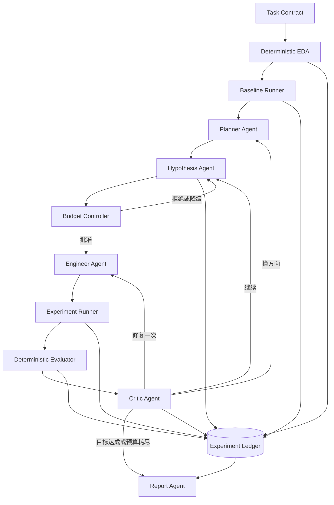

# BoHack 2026 Research Agent 系统方案

> 技术路线：Pydantic AI + 确定性 Research Controller  
> 项目暂定名：**BudgetLab**  
> 文档日期：2026-11-13  
> 目标赛道：倍漾量化｜Research Agent 系统设计

## 1. 赛题与具体要求

### 1.1 赛题目标

构建一个面向研究场景的 Research Agent System，在给定数据、工具和资源预算下，自主完成：

```text
规划 → 收集证据 → 提出假设 → 实验或分析 → 验证 → 修正
```

最终交付可追溯、可复现、可持续提升的研究成果。

### 1.2 补充要求

1. 比赛中可以忽略“必须使用本地轻量模型”的要求；如果只有一个 LLM，所有角色可以使用同一个模型。
2. 即使只有一个模型，也必须考虑 Token 成本，减少无价值调用、重复上下文和无效实验。
3. 系统可以包含多个 Agent，但重点不是角色数量，而是能否形成完整、自主的研究闭环。
4. 研究任务可以自行选择，包括机器学习、模型算子提速、软件性能优化或理论研究。
5. 应优先选择本地算力可承担、指标明确、可以快速验证的任务。
6. 赛题重点是“如何使用 Agent 做研究”，而不是研究任务本身有多复杂。
7. 必须评估 Agent 系统本身，至少包括：
   - 云端模型 Token 或费用；
   - 研究任务完成度或指标提升；
   - 总完成时间；
   - 有效实验和失败实验数量；
   - Agent 是否能根据结果改变方向；
   - Agent 是否能减少重复和无效实验。

### 1.3 时间和提交要求

统一提交代码仓库链接、路演 PPT 和项目说明。赛道在 **2026年11月14日10:00** 锁定，项目在 **2026年11月15日08:00** 截止，核心开发和材料准备窗口约为 22 小时。

## 2. 项目定位

### 2.1 一句话介绍

**BudgetLab 是一个预算感知、证据约束的机器学习 Research Agent：它在固定 Token、实验次数和时间预算下，自主提出可证伪假设、执行真实实验、根据结果修正方向，并输出可复现研究报告。**

### 2.2 要解决的问题

普通 Agent 容易出现：

- 每轮都携带完整历史，Token 成本不断增长；
- 把普通想法当成可验证假设；
- 重复运行相同实验；
- 没有提升时仍沿着原方向继续；
- LLM 同时提出方案并判断自己是否成功；
- 只保存最终结果，不保存失败实验；
- 修改评测逻辑或产生数据泄漏；
- 预算耗尽时没有明确停止策略。

### 2.3 核心差异化

1. **不可变研究契约**：Agent 可以修改实验方案，不能修改数据边界、评测器和主指标。
2. **预算感知实验分配**：根据预期收益、置信度、Token、时间和失败风险选择实验。
3. **认知与裁决分离**：LLM 提出假设，确定性 Python 代码负责执行、评分和晋级。
4. **证据驱动研究账本**：每个结论都可以回溯到假设、配置、日志和真实指标。

## 3. MVP 研究任务

第一版仅支持：

> **CSV 表格二分类或多分类任务的自主研究。**

输入：

- 训练数据 CSV；
- 目标列；
- 主指标；
- Token 预算；
- 实验次数预算；
- 总时间预算。

输出：

- 数据分析和基线；
- 假设与实验轨迹；
- 当前最优模型；
- 可复现训练配置；
- Token、时间和实验次数统计；
- 最终研究报告。

### 3.1 MVP 支持范围

- 二分类和多分类；
- `f1_macro`、`roc_auc`、`accuracy`；
- 数值和类别特征；
- 缺失值和类别不平衡处理；
- 固定交叉验证；
- sklearn 模型；
- 最多 8 至 12 次实验；
- 单实验超时；
- 失败后最多一次自动修复。

### 3.2 明确不做

- 不支持所有模态和所有机器学习问题；
- 不部署本地 LLM；
- 不建设向量数据库长期记忆；
- 不引入 Kubernetes、Slurm、Postgres 或完整 MLflow；
- 不允许 LLM 修改评测器；
- 不生成完整学术论文；
- 不在 MVP 阶段开放任意代码和任意依赖执行。

## 4. 总体架构



### 4.1 分层设计

**Agent 决策层，使用 Pydantic AI：**

- Planner Agent；
- Hypothesis Agent；
- Engineer Agent；
- Critic Agent；
- Report Agent。

**确定性控制层，使用普通 Python：**

- Research Controller；
- Budget Controller；
- 状态机和停止条件；
- 错误重试和实验去重；
- 最优实验晋级。

**工具执行层：**

- 数据剖析和数据切分；
- sklearn Pipeline 构建；
- 模型训练和交叉验证；
- 指标、时间和资源统计。

**证据层：**

- SQLite 保存结构化状态；
- JSONL 保存事件流；
- 文件目录保存配置、日志和模型；
- Git 保存代码版本。

## 5. 为什么使用 Pydantic AI

Pydantic AI 只承担模型调用、工具调用和结构化决策，不负责整个研究控制流。

选择原因：

- Pydantic schema 可以严格约束 Agent 输出；
- 工具参数可以进行类型验证；
- 结构化输出失败时可以重试；
- 可以统计每次模型调用的 usage；
- 多个角色可使用同一模型；
- 框架较轻，预算和状态逻辑容易自定义；
- 不需要同时引入 AgentScope、LangGraph 或 CrewAI。

## 6. Agent 角色

### 6.1 Planner Agent

阅读任务契约、EDA、基线和当前实验历史，判断当前应该探索、利用、换方向还是停止。

```python
class ResearchPlan(BaseModel):
    objective: str
    current_bottleneck: str
    candidate_directions: list[str]
    preferred_direction: str
    reason: str
    stop_condition: str
```

### 6.2 Hypothesis Agent

每次只提出一个主要可证伪假设，并提供证据、预期收益、成本和失败条件。

```python
class Hypothesis(BaseModel):
    id: str
    statement: str
    evidence: list[str]
    proposed_change: str
    expected_metric_delta: float
    confidence: float
    estimated_tokens: int
    estimated_seconds: int
    failure_risk: float
    falsification_condition: str
```

### 6.3 Engineer Agent

MVP 不让 Engineer 任意编写完整程序，而是生成受控实验规格：

```python
class ExperimentSpec(BaseModel):
    hypothesis_id: str
    model_family: Literal[
        "logistic_regression",
        "random_forest",
        "hist_gradient_boosting",
    ]
    preprocessing: dict
    hyperparameters: dict
    class_weight: str | None
    feature_actions: list[dict]
    random_seed: int
    notes: str
```

Runner 根据规格构建 sklearn Pipeline。相比任意生成 `train.py`，该方案更稳定、更安全，也更适合现场演示。

### 6.4 Critic Agent

判断实验是否支持原假设、提升是否可能只是波动，并建议继续、换方向、修复或停止。

```python
class CriticDecision(BaseModel):
    verdict: Literal[
        "supported",
        "refuted",
        "inconclusive",
        "execution_failed",
    ]
    action: Literal[
        "continue",
        "pivot",
        "repair_once",
        "stop_goal_met",
        "stop_budget_exhausted",
        "stop_diminishing_returns",
    ]
    reasoning: str
    evidence_refs: list[str]
    next_focus: str | None
```

### 6.5 Report Agent

Report Agent 只能读取账本中的事实，不允许虚构或重新计算指标。报告包含目标、数据、基线、假设、失败方向、最终方案、成本、限制和复现命令。

## 7. Research Controller

Controller 是系统核心，使用普通 Python 编写：

```python
async def run_research(task: TaskContract) -> FinalReport:
    state = initialize_state(task)
    state.eda = run_eda(task)
    state.baseline = run_baseline(task)

    while state.budget.can_continue():
        plan = await planner.run(build_planner_context(state))
        hypothesis = await hypothesis_agent.run(
            build_hypothesis_context(state, plan.output)
        )

        admission = budget_controller.admit(hypothesis.output, state)
        ledger.record_admission(hypothesis.output, admission)
        if not admission.approved:
            state.record_rejection(admission)
            continue

        spec = await engineer.run(
            build_engineer_context(state, hypothesis.output)
        )
        result = experiment_runner.execute(spec.output)
        metrics = evaluator.evaluate(result)

        decision = await critic.run(
            build_critic_context(state, hypothesis.output, metrics)
        )
        ledger.record_experiment(
            hypothesis.output, spec.output, result, metrics, decision.output
        )
        state.apply(decision.output, metrics)

    return await reporter.run(build_report_context(state))
```

## 8. Budget Controller

### 8.1 预算维度

- 输入和输出 Token；
- LLM 调用次数；
- 实验次数；
- 总运行时间；
- 单实验最长时间；
- 自动修复次数。

### 8.2 实验准入评分

```text
实验优先级 =
    预期指标提升 × 置信度 × 新颖度
    ------------------------------------------------
    预计Token + 时间权重×预计秒数 + 风险权重×失败风险
```

规则：

- 相同实验直接复用已有结果；
- 剩余时间不足时拒绝或降低实验规模；
- 预计 Token 超过剩余预算时拒绝；
- 预期收益小于交叉验证波动时降低优先级；
- 连续两次无提升时强制换方向；
- 连续两次执行失败时禁用对应操作；
- 达到目标分数时允许提前停止；
- 最近三次提升不足阈值时以收益递减结束。

### 8.3 Token 优化

- Planner 只读取状态摘要；
- Engineer 只读取当前假设、数据 schema 和允许空间；
- Critic 只读取当前结果和最近历史；
- 终端日志先由程序提取关键错误；
- 历史实验压缩为结构化表格；
- 指标比较和预算判断不调用 LLM；
- 重复实验不调用 LLM，也不重新训练。

## 9. 不可变研究契约

```python
class TaskContract(BaseModel):
    dataset_path: str
    target_column: str
    task_type: Literal["binary", "multiclass"]
    primary_metric: Literal["f1_macro", "roc_auc", "accuracy"]
    test_visibility: Literal["hidden"] = "hidden"
    cv_folds: int = 5
    fixed_seeds: list[int] = [42, 137, 2026]
    max_llm_tokens: int
    max_llm_calls: int
    max_experiments: int
    max_minutes: int
    experiment_timeout_seconds: int
    allowed_model_families: list[str]
```

必须保证：

- Agent 无法修改 TaskContract；
- 测试集标签不进入 Agent 上下文；
- Evaluator 从独立模块加载；
- 指标由程序写入，不由 LLM 手填；
- 最终模型按预先声明的规则选择；
- 随机种子、依赖和运行命令全部记录。

## 10. 实验账本

```text
runs/run_20261114_001/
├── task_contract.yaml
├── research_state.json
├── events.jsonl
├── ledger.sqlite
├── eda/summary.json
├── baseline/metrics.json
├── experiments/
│   ├── exp_001/
│   │   ├── hypothesis.json
│   │   ├── admission.json
│   │   ├── experiment_spec.json
│   │   ├── metrics.json
│   │   ├── stdout.log
│   │   ├── stderr.log
│   │   └── decision.json
│   └── exp_002/
├── best/
│   ├── pipeline.joblib
│   ├── experiment_spec.json
│   └── metrics.json
└── final_report.md
```

SQLite 建议表：`runs`、`llm_calls`、`hypotheses`、`experiments`、`metrics`、`decisions`、`artifacts` 和 `lessons`。

## 11. 项目目录结构

```text
bohack/
├── README.md
├── pyproject.toml
├── .env.example
├── configs/
│   └── demo.yaml
├── data/
│   └── demo.csv
├── budgetlab/
│   ├── cli.py
│   ├── controller.py
│   ├── state.py
│   ├── contracts.py
│   ├── budget.py
│   ├── ledger.py
│   ├── llm.py
│   ├── agents/
│   │   ├── planner.py
│   │   ├── hypothesis.py
│   │   ├── engineer.py
│   │   ├── critic.py
│   │   └── reporter.py
│   ├── schemas/
│   │   ├── plan.py
│   │   ├── hypothesis.py
│   │   ├── experiment.py
│   │   └── decision.py
│   ├── tools/
│   │   ├── eda.py
│   │   ├── pipeline_factory.py
│   │   ├── runner.py
│   │   ├── evaluator.py
│   │   └── profiler.py
│   └── ui/
│       └── app.py
├── prompts/
├── tests/
└── runs/
```

## 12. 技术栈与安装

### 12.1 基础依赖

```powershell
uv init
uv add pydantic-ai pydantic pyyaml python-dotenv
uv add pandas numpy scikit-learn optuna joblib psutil
uv add streamlit plotly rich typer
uv add --dev pytest ruff
```

仅在闭环跑通后考虑：

```powershell
uv add xgboost lightgbm
```

### 12.2 环境变量

```dotenv
LLM_BASE_URL=
LLM_API_KEY=
LLM_MODEL=
MAX_LLM_TOKENS=30000
MAX_LLM_CALLS=30
```

API Key 不得提交到仓库。

## 13. 评估方案

### 13.1 研究结果指标

- 初始基线分数；
- 最终最佳分数；
- 绝对和相对提升；
- 是否达到目标；
- 交叉验证均值和标准差。

### 13.2 Agent 系统指标

- 总输入和输出 Token；
- 总 LLM 调用次数；
- 总完成时间；
- 实验、失败和拒绝数量；
- 重复实验拦截数；
- 有效假设比例；
- 每 1,000 Token 带来的指标提升；
- 每分钟带来的指标提升；
- 自动错误恢复率；
- 预算内完成率。

### 13.3 对照组

**Baseline A：固定 AutoML**

- 不使用 LLM；
- 按固定顺序训练若干模型；
- 使用相同实验次数或时间预算。

**Baseline B：朴素单 Agent**

- 每轮给 LLM 完整历史；
- 不做实验准入、重复检测和收益递减停止；
- 在相同 Token 或时间预算下运行。

**Treatment：BudgetLab**

- 结构化研究状态；
- 假设驱动；
- 预算准入；
- 确定性评测；
- 实验去重；
- 提前停止；
- 证据账本。

### 13.4 结果表

| 系统 | 最终 F1 | 相对基线提升 | Token | 时间 | 实验数 | 失败数 |
|---|---:|---:|---:|---:|---:|---:|
| 固定 AutoML | 待测 | 待测 | 0 | 待测 | 待测 | 待测 |
| 朴素 Agent | 待测 | 待测 | 待测 | 待测 | 待测 | 待测 |
| BudgetLab | 待测 | 待测 | 待测 | 待测 | 待测 | 待测 |

不要只展示一个自定义综合分，应同时展示原始性能、Token、时间和实验数。

## 14. 可视化界面

使用 Streamlit 实现五个区域：

1. **任务配置**：上传 CSV，选择目标列、主指标和预算。
2. **实时轨迹**：当前阶段、假设、剩余预算、实验状态和最近决定。
3. **性能与成本**：最佳指标随实验次数、累计 Token 和累计时间的变化。
4. **证据链**：从结论回溯到假设、配置、日志和指标。
5. **最终报告**：最终方案、失败方向、成本、限制和复现命令。

核心图表：

- 横轴累计 Token，纵轴当前最佳 F1；
- 横轴累计时间，纵轴当前最佳 F1；
- 不同角色 Token 占比；
- 成功、失败、拒绝和复用实验数量。

## 15. 22 小时开发计划

### T+0 至 T+2：项目骨架

- 初始化仓库和依赖；
- 完成 TaskContract 和 ResearchState；
- 准备固定 Demo 数据；
- 确认模型 API 可用。

### T+2 至 T+6：确定性实验系统

- EDA 和 baseline；
- sklearn PipelineFactory；
- 交叉验证 Evaluator；
- timeout Runner；
- metrics 输出。

此阶段必须先做到：**不用任何 Agent 也可以完整训练和评测。**

### T+6 至 T+10：Pydantic AI 节点

- Planner、Hypothesis、Engineer、Critic；
- Pydantic schema；
- Prompt 测试；
- usage 统计。

### T+10 至 T+13：Controller 与预算

- 研究主循环；
- Token 统计；
- 实验准入和去重；
- 停止条件；
- SQLite 账本。

### T+13 至 T+16：端到端验证

- 至少在两个数据集运行；
- 修复错误；
- 固定最终 Demo 数据集；
- 保存一次完整成功轨迹。

### T+16 至 T+19：界面和可视化

- Streamlit；
- 指标和 Token 曲线；
- 证据链；
- 最终报告展示。

### T+19 至 T+22：提交与路演

- README、项目说明和 PPT；
- Demo 录屏；
- 清理 API Key；
- 从空环境复现安装；
- 准备接口失败时的 replay 模式。

## 16. 演示流程

演示控制在 3 至 5 分钟：

1. 展示一个 CSV 分类任务和预算参数。
2. 启动研究，自动完成 EDA 和基线。
3. 展示第一个假设、预期收益和成本估计。
4. 展示 Budget Controller 为什么批准或拒绝实验。
5. 展示真实训练日志和指标。
6. 展示 Critic 如何支持、否定或修正假设。
7. 展示系统换方向并执行下一轮。
8. 展示最终性能、Token、时间和实验数量。
9. 点击最终结论，回溯到实验配置和日志。
10. 展示与朴素 Agent 的对照结果。

路演核心表述：

> 相同模型、相同数据、相同预算下，BudgetLab 不让 LLM 无限尝试，而是把有限研究资源投入最值得验证的方向，并保证每个结论都有真实实验支持。

## 17. 风险与降级

| 风险 | 处理方式 |
|---|---|
| LLM 接口不稳定 | 保存完整成功运行，提供 replay 模式 |
| 结构化输出失败 | Pydantic 校验后重试一次，仍失败则使用保守模板 |
| 非法实验参数 | allowlist + schema 限制 |
| 实验运行过慢 | timeout + 小样本 pilot + 禁用重模型 |
| 指标没有提升 | 展示正确否定假设和预算控制，不伪造结果 |
| Token 太高 | 状态摘要、日志压缩、减少 Planner 调用 |
| 数据泄漏 | 确定性 leakage 检查 + 隐藏测试集 |
| 现场失败 | 固定数据和种子，准备录屏和回放 |
| 时间不足 | 删除任意代码生成，仅保留 ExperimentSpec 模式 |

## 18. 验收标准

- [ ] 能读取一个新 CSV 数据集；
- [ ] 能自动完成基础 EDA；
- [ ] 能建立并保存基线；
- [ ] 能提出至少两个可证伪假设；
- [ ] 能执行至少两轮真实实验；
- [ ] 能根据结果继续或换方向；
- [ ] 能记录 Token、时间和实验数量；
- [ ] 能阻止至少一种重复或超预算实验；
- [ ] 能输出最终最优方案；
- [ ] 能从结论回溯到实验日志；
- [ ] 能一条命令复现 Demo；
- [ ] 能展示与固定 AutoML 或朴素 Agent 的对照结果。

## 19. 团队分工建议

### Agent 与控制器

- Pydantic AI Agent；
- Prompt；
- Research Controller；
- Budget Controller。

### ML 与评测

- EDA；
- PipelineFactory；
- 交叉验证；
- 数据泄漏检查；
- 对照实验。

### 前端与材料

- Streamlit 和 Plotly；
- README、项目说明和 PPT；
- Demo 脚本、录屏和备用方案。

如果只有两人，优先保证 Controller、实验系统、结果曲线和证据链，减少 UI 页面数量。

## 20. MVP 完成后的增强

- 并行候选假设；
- MCTS 预算分配；
- OpenCode 作为 Engineer 执行器；
- Docker 沙箱；
- 跨任务经验库；
- 多模型角色路由；
- 多随机种子自动确认；
- SHAP 解释；
- 软件性能优化或模型算子任务。

## 21. 参考项目

- Ramanujan：https://github.com/Abhinoob1501/ramanujan
- STEER：https://github.com/xieyulai/steer
- Faberon：https://github.com/sevren-ai/faberon
- Research Direction Selector：https://github.com/kongtou20070406/research-direction-selector
- Open Research Agent：https://github.com/Jialei-03/open-research-agent
- ByteRush：https://github.com/yurunzzz/ByteRush--TechJam
- Pydantic AI：https://github.com/pydantic/pydantic-ai

参考项目时必须检查并遵守各自许可证，保持自身代码和贡献边界清晰。

## 22. 立即执行任务

1. 初始化 `uv` 项目并安装最小依赖。
2. 确认比赛模型 API 的 Base URL、模型名和 usage 返回格式。
3. 选定稳定的 Demo CSV 数据集。
4. 实现完全不依赖 LLM 的 baseline、Runner 和 Evaluator。
5. 定义 TaskContract、ResearchState、Hypothesis 和 ExperimentSpec。
6. 接入 Hypothesis Agent，验证 Pydantic 结构化输出。
7. 跑通“一个假设 → 一个真实实验 → 一个 Critic 决策”的最小闭环。
8. 增加预算准入、实验账本、界面和对照实验。
